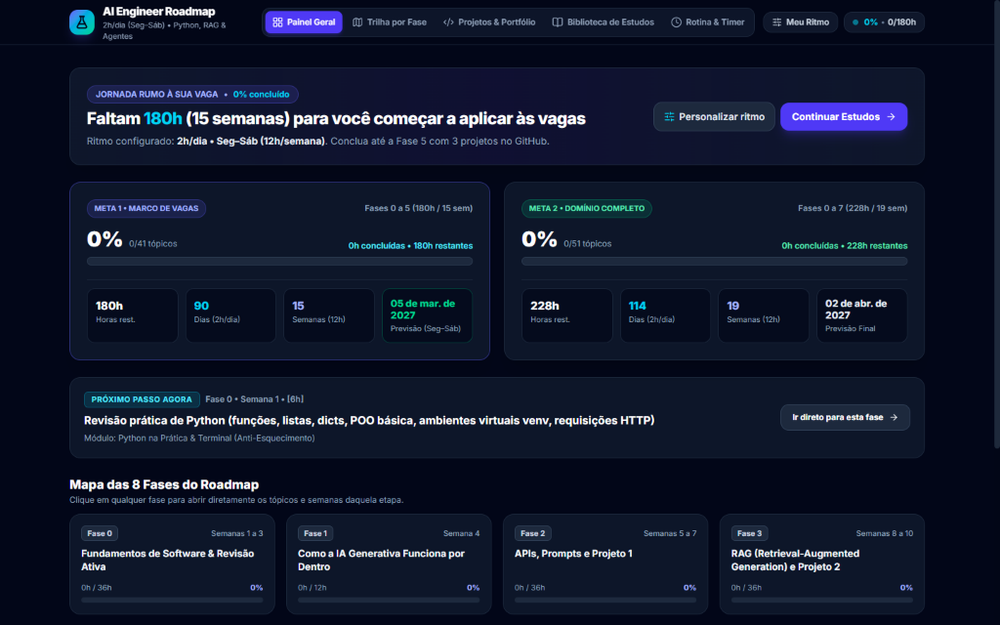

<div align="center">

<br />

<h1>🧪 AI Engineer Roadmap</h1>

<p>
  <strong>Um painel interativo open-source para transformar o estudo de Engenharia de IA em uma rotina clara, mensurável e anti-esquecimento — do Python &amp; SQL ao deploy de Agentes em produção.</strong>
</p>

<p>
  
  
  
  
</p>

<p>
  
  
  
  
  
</p>

<p>
  <a href="https://fernandodlts.github.io/roadmap-ai-engineer/">
    
  </a>
</p>

<p>
  <a href="#por-que-usar">✨ Diferenciais</a> &nbsp;•&nbsp;
  <a href="#telas">🧭 Telas do App</a> &nbsp;•&nbsp;
  <a href="#jornada">🗺️ As 8 Fases</a> &nbsp;•&nbsp;
  <a href="#projetos">🚀 5 Projetos</a> &nbsp;•&nbsp;
  <a href="#anti-esquecimento">🧠 Anti-Esquecimento</a> &nbsp;•&nbsp;
  <a href="#arquitetura">🏗️ Arquitetura</a> &nbsp;•&nbsp;
  <a href="#como-rodar">⚡ Rodar Localmente</a>
</p>

<br />



<sub><i>Painel Geral com recálculo em tempo real de horas, dias, semanas e data estimada para o Marco de Vagas (Fase 5) e Domínio Completo (Fase 7).</i></sub>

</div>

---

<a id="por-que-usar"></a>

## ✨ Por que estudar com este Roadmap?

A maioria dos roadmaps de IA são apenas listas estáticas gigantes que geram ansiedade e nunca mostram **quando você já está pronto para aplicar às vagas**. Este projeto resolve isso com engenharia prática:

> [!IMPORTANT]
> **Você não precisa esperar 100% do roadmap para começar a se candidatar.** O painel separa automaticamente sua jornada em **duas metas estratégicas**:
> - **🎯 Meta 1 — Marco de Vagas (`Fases 0 a 5` • `180h` • `41 tópicos`):** Python, SQL, LLMs, Structured Outputs, RAG Híbrido, LangGraph, MCP, A2A, Guardrails, HITL + **3 projetos reais no GitHub**. Chegou aqui? Comece a aplicar imediatamente.
> - **🏆 Meta 2 — Domínio Completo (`Fases 0 a 7` • `228h` • `51 tópicos`):** Avaliação rigorosa com Ragas, LLM-as-a-Judge e Red Teaming + Deploy em produção com FastAPI, Docker, Cloud e CI/CD + **2 projetos diferenciais**.

| Pilar | O que o painel faz por você |
| :--- | :--- |
| ⏱️ **Cálculo Dinâmico Real** | Marque qualquer tópico e veja **horas, dias, semanas e data estimada** recalcularem instantaneamente pulando seus dias de folga. |
| 🎛️ **Ritmo 100% Personalizável** | Configure de `0,5h` a `12h/dia` e os dias exatos da semana (`Seg` a `Dom`) — ou ative o modo **No meu ritmo (sem dias fixos)**. |
| 🧠 **Sistema Anti-Esquecimento** | Combina **Curva do Esquecimento (`D+1`, `D+7`, `D+21`)** sobre os tópicos que você concluiu + **gerador de prompts socráticos** para Claude/ChatGPT + plataformas reais (**LeetCode Python**, **SQLBolt**, **LeetCode SQL 50**, **StrataScratch**). |
| 📂 **Foco em Portfólio Real** | Cada um dos 5 projetos tem checklist de 4 etapas (código rodando, variação original, README profissional e post técnico no LinkedIn) + link salvo do seu GitHub. |
| 💾 **Privacidade & Portabilidade** | Zero cadastro, zero custo de servidor. Tudo salva automaticamente no `localStorage`, sincroniza entre abas abertas e exporta/importa **backup completo em JSON**. |

---

<a id="telas"></a>

## 🧭 Visão Geral das Telas

| Tela | Rota URL | O que oferece |
| :--- | :--- | :--- |
| **📊 Painel Geral** | `/` | Hero dinâmico, cards da **Meta 1** e **Meta 2**, card **Próximo Passo Agora**, mapa clicável das 8 fases e controle de Backup/Reset JSON. |
| **🗺️ Trilha por Fase** | `/?tab=roadmap&phase=0` | Sub-abas da Fase 0 à Fase 7, checkboxes por tópico ou semana inteira, recursos recomendados expansíveis e **anotações pessoais por semana**. |
| **💻 Projetos & Portfólio** | `/?tab=projetos` | Os 5 projetos práticos divididos em *Obrigatórios (1–3)* e *Diferenciais (4–5)*, barra de entrega global e campo validado para URL do repositório GitHub. |
| **📚 Biblioteca de Estudos** | `/?tab=biblioteca` | **41 materiais curados** (vídeos, docs oficiais, repositórios GitHub, livros e cursos gratuitos) com busca instantânea, filtro por tipo/fase, favoritos e status *Estudado*. |
| **⏳ Rotina & Timer** | `/?tab=rotina` | Cronômetro sincronizado com relógio real (não atrasa em segundo plano), Tracker Semanal adaptável, **Hub de Revisão Espaçada + Prática Infinita** e Guia de Carreira. |
| **🎛️ Meu Ritmo** | `/?tab=ritmo` | Estúdio de personalização com modo **Dias e horas definidos** ou **No meu ritmo (livre)** e simulador em tempo real do impacto nas datas das metas. |

---

<a id="jornada"></a>

## 🗺️ Mapa Visual da Jornada (8 Fases • 19 Semanas • 228h)

```mermaid
flowchart LR
    F0["Fase 0 · 36h<br/>Python, SQL, Git<br/>Pandas & Scraping"] --> F1["Fase 1 · 12h<br/>Tokens, Embeddings<br/>& Temperatura"]
    F1 --> F2["Fase 2 · 36h<br/>APIs, Prompts, Pydantic<br/>+ Projeto 1"]
    F2 --> F3["Fase 3 · 36h<br/>RAG Híbrido, BM25<br/>Reranking + Projeto 2"]
    F3 --> F4["Fase 4 · 24h<br/>LangGraph, Memória<br/>& Tracing"]
    F4 --> F5["🎯 Fase 5 · 36h<br/>MCP, A2A, Guardrails<br/>HITL + Projeto 3"]
    F5 ==> VAGA(["✅ MARCO DE VAGAS<br/>180h · 3 Projetos no GitHub"])
    VAGA -.-> F6["Fase 6 · 24h<br/>Evals, Ragas, Red Teaming<br/>+ Projeto 4"]
    F6 -.-> F7["🚀 Fase 7 · 24h<br/>FastAPI, Docker, Cloud<br/>CI/CD + Projeto 5"]
```



### Resumo das Fases

| Fase | Semanas | Carga | Foco Técnico | Entrega Principal |
| :---: | :---: | :---: | :--- | :--- |
| **Fase 0** | Sem 1–3 | `36h` | Python prático, Terminal + Claude Code, Git/GitHub, SQL, Pandas e Web Scraping | CLI em Python + 1º post técnico |
| **Fase 1** | Sem 4 | `12h` | LLM/SLM/LRM/VLM, tokenização, contexto, embeddings, Softmax/Euler e alucinações | Domínio dos fundamentos reais |
| **Fase 2** | Sem 5–7 | `36h` | SDKs OpenAI/Anthropic, LangChain, início LangGraph, Pydantic, ReAct/Tools e Prompting | **Projeto 1:** Extrator de Contratos |
| **Fase 3** | Sem 8–10 | `36h` | Bancos vetoriais, chunking, cosseno, busca híbrida (BM25), RRF/ColBERT e Agentic RAG | **Projeto 2:** Assistente RAG com Fontes |
| **Fase 4** | Sem 11–12 | `24h` | Loop agêntico, grafos de estado, checkpointers, Langfuse/LangSmith/Opik e memória | Agentes com estado e tracing |
| **🎯 Fase 5** | Sem 13–15 | `36h` | MCP (Anthropic), A2A (Google), Multiagentes, Guardrails, HITL e base de FastAPI | **Projeto 3:** Agente HITL + **Aplicar às Vagas** |
| **Fase 6** | Sem 16–17 | `24h` | Métricas clássicas vs LLM-as-a-Judge, Red Teaming, Golden Datasets, Ragas e CI | **Projeto 4:** Benchmark do Agente |
| **Fase 7** | Sem 18–19 | `24h` | FastAPI completo, Docker, CI/CD, Cloud (AWS/Azure/GCP), Auth, Rate Limit e Logs | **Projeto 5:** Agente em Produção |

<details>
<summary><strong>📖 Clique para explorar todas as 19 semanas e os 51 tópicos detalhados</strong></summary>

<br />

#### 🔹 Fase 0 — Fundamentos de Software & Revisão Ativa (`36h`)
- **Semana 1 — Python na Prática & Terminal (Anti-Esquecimento):** Revisão de Python (`6h`) • Terminal & Claude Code (`4h`) • Mini-desafio CLI sem copiar código (`2h`)
- **Semana 2 — Git, GitHub e SQL Essencial:** Git/GitHub com branches, PRs e README (`6h`) • Revisão de SQL essencial e leitura crítica (`6h`)
- **Semana 3 — Pandas, Web Scraping e Primeiro Post:** DataFrames e limpeza CSV/JSON (`6h`) • BeautifulSoup + Playwright/Selenium (`4h`) • Revisão + 1º post no LinkedIn (`2h`)

#### 🔹 Fase 1 — Como a IA Generativa Funciona por Dentro (`12h`)
- **Semana 4 — Por Dentro dos LLMs:** LLM vs SLM vs LRM vs VLM (`3h`) • Tokens e janela de contexto (`3h`) • Embeddings vetoriais (`3h`) • Temperatura (Softmax/Euler) e alucinações (`3h`)

#### 🔹 Fase 2 — APIs, Prompts e Projeto 1 (`36h`)
- **Semana 5 — SDKs, LangChain e LangGraph:** Chamadas de API via SDKs (`4h`) • Padronização `.invoke` (`4h`) • Introdução a nós e arestas no LangGraph (`4h`)
- **Semana 6 — Structured Outputs, Tools e Prompting:** JSON tipado com Pydantic (`4h`) • Padrão ReAct & Tool Calling (`4h`) • Zero/Few-shot, CoT, ToT e CoVe (`4h`)
- **Semana 7 — 🚀 Projeto Prático 1:** Extrator Inteligente de Contratos em PDF → JSON estruturado (`8h`) • Variação original + GitHub + post LinkedIn (`4h`)

#### 🔹 Fase 3 — RAG (Retrieval-Augmented Generation) e Projeto 2 (`36h`)
- **Semana 8 — Arquitetura RAG & Vetores:** Bancos vetoriais (`4h`) • Chunking & embeddings (`4h`) • Similaridade de cosseno e geração (`4h`)
- **Semana 9 — Busca Híbrida, Reranking e Agentic RAG:** Vetorial + BM25 (`4h`) • Reranking RRF & ColBERT (`4h`) • Agentic RAG (`4h`)
- **Semana 10 — 🚀 Projeto Prático 2:** Assistente de Documentação com RAG citando fontes via metadados (`8h`) • GitHub + post técnico (`4h`)

#### 🔹 Fase 4 — Agentes I: Estado, Memória e Observabilidade (`24h`)
- **Semana 11 — Loop Agêntico & Persistência:** Loop agêntico / harness (`4h`) • Grafos de estado no LangGraph (`4h`) • Threads e Checkpointers (`4h`)
- **Semana 12 — Observabilidade & Memória:** Tracing com Langfuse, LangSmith ou Opik (`6h`) • Memória de curto e longo prazo: semântica, episódica e procedural (`6h`)

#### 🎯 Fase 5 — Agentes II: Protocolos, Segurança e Projeto 3 (`36h` — Marco de Vagas)
- **Semana 13 — Protocolos & Multiagentes:** MCP da Anthropic (`4h`) • A2A do Google (`4h`) • Sistemas Multiagênticos no LangGraph (`4h`)
- **Semana 14 — Segurança, HITL & FastAPI:** Guardrails determinísticos (regex) e não determinísticos (`5h`) • Human-in-the-Loop (`4h`) • Noções iniciais de FastAPI (`3h`)
- **Semana 15 — 🎯 Projeto Prático 3 + Vagas:** Agente de Atendimento com RAG + Tools + aprovação humana HITL (`8h`) • Portfólio, currículo/LinkedIn e início das aplicações (`4h`)

#### 🔹 Fase 6 — Avaliação de Sistemas de IA (Evaluation) e Projeto 4 (`24h`)
- **Semana 16 — Métricas, Red Teaming & Ragas:** Métricas tradicionais vs LLM-as-a-Judge (`4h`) • Red Teaming adversarial (`4h`) • Golden Datasets vivos e Ragas (`4h`)
- **Semana 17 — 🚀 Projeto Prático 4 (Benchmark):** Testes de regressão em CI (`4h`) • Benchmark completo do Projeto 3 com Golden Dataset, Ragas e Red Teaming (`8h`)

#### 🔹 Fase 7 — Deploy, Produção e LLMOps e Projeto 5 (`24h`)
- **Semana 18 — FastAPI, Docker & Cloud:** FastAPI estruturado (`4h`) • Dockerfile e containerização (`4h`) • CI/CD, Cloud, Rate Limit, Auth e Logs (`4h`)
- **Semana 19 — 🚀 Projeto Prático 5 (Produção):** Agente em API FastAPI + Docker na nuvem com auth, rate limit, logs e CI/CD (`10h`) • Arquitetura Python em produção vs No-Code/n8n (`2h`)

</details>

---

<a id="projetos"></a>

## 🚀 Os 5 Projetos de Portfólio

Recrutadores contratam quem mostra **código real funcionando**. Cada projeto no app traz um checklist fixo de 4 marcos:
`[1] Código testado localmente` → `[2] Variação original do tema` → `[3] Repo no GitHub com README e prints` → `[4] Post técnico no LinkedIn`.

| # | Projeto | Etapa | Stack Principal | Papel na Candidatura |
| :---: | :--- | :---: | :--- | :--- |
| **#1** | **Extrator Inteligente de Contratos** | Fase 2 • Sem 7 | APIs de LLM, Pydantic, Structured Outputs, Prompting | 🎯 Obrigatório p/ aplicar |
| **#2** | **Assistente de Documentação com RAG** | Fase 3 • Sem 10 | Banco Vetorial, BM25 + Vetorial, Reranking, Metadados | 🎯 Obrigatório p/ aplicar |
| **#3** | **Agente de Atendimento com HITL** | Fase 5 • Sem 15 | LangGraph, RAG + Tools, MCP, Guardrails, Aprovação Humana | 🎯 Obrigatório p/ aplicar |
| **#4** | **Benchmark Completo do Agente** | Fase 6 • Sem 17 | Golden Dataset, Ragas, LLM-as-a-Judge, Red Teaming, CI | ⭐ Diferencial Pós-Fase 5 |
| **#5** | **Agente em Produção (Cloud)** | Fase 7 • Sem 19 | FastAPI, Docker, Cloud, Auth, Rate Limit, Logs, CI/CD | ⭐ Diferencial Pós-Fase 5 |

---

<a id="anti-esquecimento"></a>

## 🧠 Sistema Anti-Esquecimento (Sem Repetir Questões Fixas)

Em jornadas de 4 a 5 meses, um banco estático de exercícios perde a utilidade em duas semanas. Por isso, a aba **Rotina & Timer** combina três mecanismos que escalam ao infinito:

1. **Sessão Guiada com Cronômetro Real (`2h/dia` padrão):**
   - `15 min` **Revisão Ativa (Python/SQL)** → `30 min` **Teoria Focada** → `75 min` **Mão na Massa (Código)** (além de preset `25 min Pomodoro`).
   - O timer calcula tempo por **timestamp real (`endTime - Date.now()`)**, não atrasa quando você alterna para o VS Code, mostra contagem regressiva no `<title>` da aba e toca um aviso sonoro suave via Web Audio API.
2. **Curva do Esquecimento Automática (`D+1` • `D+7` • `D+21`):**
   - Ao marcar qualquer tópico concluído na trilha, o app agenda revisões em **1, 7 e 21 dias**, resgatando suas **anotações pessoais daquela semana** até consolidar o assunto (`3/3`).
3. **Prática Infinita de Python & SQL:**
   - **Gerador de Prompt Socrático (1 clique):** cria um prompt personalizado com sua **fase atual** e seus **tópicos vencendo hoje** para colar no Claude ou ChatGPT — instruindo a IA a gerar desafios inéditos e **nunca entregar o código antes de você tentar**.
   - **Acesso direto a plataformas com correção real:** [LeetCode Python](https://leetcode.com/problemset/), [SQLBolt](https://sqlbolt.com/), [LeetCode SQL 50](https://leetcode.com/studyplan/top-sql-50/) e [StrataScratch](https://www.stratascratch.com/).

---

<a id="arquitetura"></a>

## 🏗️ Arquitetura Técnica

Construído como uma SPA moderna, rápida e 100% client-side, publicada diretamente pelo **GitHub Pages** com deploy automático via GitHub Actions:

```text
roadmap-ai-engineer/
├── .github/workflows/deploy.yml # CI/CD: testa, compila e publica no GitHub Pages
├── index.html                   # Entry point HTML + favicon SVG + fonte Inter
├── vite.config.ts               # Vite 8 + React + Tailwind CSS v4 + Vitest
└── src/
    ├── types/roadmap.ts        # Contratos TypeScript de todo o domínio e estado
    ├── data/                   # Dados puros e fáceis de editar (fases, semanas, projetos, biblioteca, rotina)
    ├── utils/
    │   ├── metrics.ts          # Recálculo de metas, carga semanal e ETA pulando dias de folga
    │   ├── spacedRepetition.ts # Fila D+1 / D+7 / D+21 e construtor de prompts socráticos
    │   ├── storage.ts          # Persistência localStorage, sanitização de URLs e Backup JSON
    │   ├── audio.ts            # Sintetizador de alerta sonoro via Web Audio API
    │   └── *.test.ts           # 13 testes unitários com Vitest
    ├── hooks/
    │   ├── useRoadmapState.ts  # Estado persistido + sincronização entre abas abertas
    │   ├── useStudyTimer.ts    # Cronômetro drift-free com sincronização no <title>
    │   ├── useUrlNavigation.ts # Estado da aba e fase refletido na URL (?tab=...&phase=...)
    │   └── useToasts.ts        # Fila de notificações não-bloqueantes
    └── components/
        ├── layout/             # Header responsivo, ResetModal acessível, ToastContainer
        ├── routine/            # ActiveReviewHub (Revisão Espaçada + Prompt IA + Plataformas)
        └── tabs/               # DashboardTab, PhasesTab, ProjectsTab, LibraryTab, RoutineTab, ScheduleTab
```

> [!TIP]
> **Quer adaptar este roadmap para a sua própria trilha?** Toda a estrutura de fases, semanas, pesos em horas, projetos e links vive isolada em `src/data/` — basta editar os arquivos tipados sem precisar mexer na interface.

---

<a id="como-rodar"></a>

## ⚡ Como Rodar Localmente

### Pré-requisitos
- **Node.js 20+** e **npm**

### Instalação e desenvolvimento

```bash
# 1. Clone o repositório
git clone https://github.com/fernandodlts/roadmap-ai-engineer.git
cd roadmap-ai-engineer

# 2. Instale as dependências
npm install

# 3. Inicie o servidor local de desenvolvimento
npm run dev
```

### Scripts disponíveis

| Comando | Descrição |
| :--- | :--- |
| `npm run dev` | Inicia o servidor Vite com Hot Module Replacement |
| `npm test` | Executa a suíte de **13 testes unitários** (Vitest) |
| `npm run typecheck` | Valida a tipagem estrita do TypeScript sem gerar arquivos |
| `npm run build` | Valida TypeScript (`tsc -b`) e gera o bundle otimizado em `dist/` |
| `npm run preview` | Pré-visualiza localmente o build final de produção |

---

<div align="center">
  <sub>Feito com foco em consistência diária, código real e portfólio prático em Engenharia de IA.</sub>
</div>
